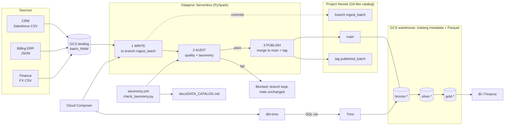
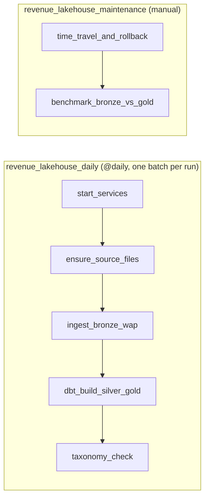

# System design: revenue lakehouse on Apache Iceberg

This page explains how the system is put together, one step at a time. Follow it in order and you can redraw the design on a whiteboard.

## 1. Problem and requirements

Revenue data for a B2B SaaS company sits in three systems that disagree: CRM (customers and deals), billing (invoices and payments, many currencies) and finance (FX rates). The old data lake was a folder of files: schema changes broke jobs, bad loads overwrote good data, nobody knew which table to trust, and duplicate CRM accounts made revenue per customer wrong.

| Type | Requirement | How the design meets it |
|---|---|---|
| Functional | Trusted MRR/ARR bridge, churn, AR aging, pipeline by segment | dbt Gold models on Trino |
| Correctness | A bad batch must never reach reporting | Write-Audit-Publish on a Nessie branch |
| Correctness | One customer counted once | `int_account_master_map` de-duplicates CRM accounts |
| Evolution | Sources can add columns without breaking anything | Iceberg schema evolution (`mergeSchema`) |
| Recovery | Undo a bad write in one step; query any past version | Nessie commits, tags and branch reset; Iceberg snapshots |
| Governance | Every table has an owner, a layer, a description and a standard name | `governance/taxonomy.yml` enforced by `check_taxonomy.py` |
| Performance | Reports fast enough for BI | Gold tables pre-aggregated (61% faster than querying Bronze) |

## 2. Architecture (production, GCP)



## 3. Local stand-ins

| Production | Local in this repo |
|---|---|
| GCS bucket | SeaweedFS (S3 API) on `:8333` |
| Nessie on Cloud Run or GKE | Nessie container on `:19120` |
| Dataproc Serverless | PySpark on the laptop with the Iceberg and Nessie extensions |
| Trino on GKE / Starburst | Trino container on `:8080` |
| Cloud Composer | Airflow 3.2 standalone (`airflow/dags/`) |

## 4. One batch, step by step

**Step 1. Files land.** Each day a batch arrives in the landing area: CRM accounts and opportunities (CSV), billing invoices and payments (JSON), FX rates (CSV). `generator/generate_revenue_data.py` creates three batches. Batch 2 adds a new column (`tax_amount`). Batch 3 is deliberately broken (null IDs, negative amounts).

**Step 2. WRITE to a branch** (`ingestion/ingest_batch.py`). Spark asks Nessie to create a branch `ingest_<batch>` from `main`, just like `git checkout -b`. It reads each source file, adds load metadata (`_batch_id`, `_ingested_at`, `_source_file`) and writes the Bronze Iceberg tables **on the branch**. Readers of `main` see nothing yet.

**Step 3. Schema evolution happens here.** The write uses `mergeSchema`, so when billing adds `tax_amount` the column is added to the live table as a metadata change. No files are rewritten and older rows read the new column as null.

**Step 4. AUDIT the branch.** Checks run against the branch only: row counts, no null keys, no negative amounts, and the taxonomy rules (table name pattern, required columns, required table properties such as `data_owner`, `domain`, `layer`, `description`).

**Step 5. PUBLISH or block.**
- All checks pass: the branch is merged into `main` in one atomic commit, the branch is deleted and `main` is tagged `published_<batch>`. Every table in the batch becomes visible at the same moment, so nobody ever sees half a load.
- Any check fails: the job exits non-zero, the branch is kept for debugging and `main` is untouched. In Airflow the task goes red and dbt is marked `upstream_failed`. This is what happens to `batch_003`.

**Step 6. Silver with dbt on Trino.** dbt sends SQL to Trino, which reads and writes Iceberg tables through the Nessie catalog.
- `stg_crm__accounts`, `stg_crm__opportunities`, `stg_billing__invoices`, `stg_billing__payments`, `stg_finance__fx_rates`: typed, renamed, de-duplicated.
- `int_account_master_map`: matches duplicate CRM accounts (197 records become 180 real customers) so revenue is counted once per customer.
- Seeds `ref_country_codes`, `ref_opportunity_stages`: reference data.

**Step 7. Gold with dbt.**

| Gold table | Answers |
|---|---|
| `dim_account` | One row per real customer, with segment and region |
| `fct_invoices` | Every invoice in USD (FX applied) |
| `fct_opportunities` | Every deal with its stage |
| `rpt_mrr_movements` | MRR bridge per customer per month: new, expansion, contraction, churn |
| `rpt_revenue_monthly` | MRR, ARR and the bridge per month |
| `rpt_ar_aging` | Unpaid invoices by age bucket |
| `rpt_pipeline_by_segment` | Open pipeline by segment and stage |

Tests include `assert_mrr_bridge_reconciles` (opening MRR + movements = closing MRR) and `assert_invoices_have_fx_rate`.

**Step 8. Govern.** `check_taxonomy.py` checks every table in the catalog against `taxonomy.yml` (20 of 20 pass) and writes `docs/DATA_CATALOG.md`, so owners, layers and descriptions are documented from the live catalog, not by hand.

**Step 9. Time travel and recovery** (`revenue_lakehouse_maintenance`). Any table can be read as of a tag (for example `published_batch_001`, before `tax_amount` existed). An accidental `DELETE` on a Gold table is undone by resetting `main` to the previous Nessie commit.

## 5. Orchestration



The 3 July run is red on purpose: `ingest_bronze_wap` blocks `batch_003`, and everything downstream is skipped, so reporting keeps showing 2 July's good data.

## 6. Design decisions and trade-offs

| Decision | Why | Trade-off |
|---|---|---|
| Iceberg as the table format | ACID writes, schema evolution, snapshots, open format readable by Spark and Trino | More metadata to manage (compaction, snapshot expiry) |
| Nessie catalog | Branches and tags across many tables, so Write-Audit-Publish is atomic for the whole batch | One more service to run; Iceberg's REST catalog alone has no cross-table branches |
| Write-Audit-Publish | Bad data is caught before anyone can read it | Each batch costs a branch create and a merge (cheap, metadata only) |
| Spark for ingestion, Trino for modelling | Spark is good at loading files; Trino is fast interactive SQL and dbt has a mature adapter | Two engines to operate |
| Taxonomy as code | Rules are reviewed in Git and enforced automatically | Teams must follow naming rules (the seeds had to be renamed `ref_*`) |
| Pre-aggregated Gold | 111 ms vs 283 ms for the same answer; cheaper BI | Gold must be rebuilt when Silver changes |

## 7. Failure handling

| What goes wrong | What happens |
|---|---|
| Bad rows in a batch | Audit fails, branch kept, `main` unchanged, dbt skipped |
| New column in a source | Added automatically through schema evolution |
| Accidental delete or bad transform | Reset `main` to the previous commit, or read the table at a tag |
| Table breaks the naming or ownership rules | `taxonomy_check` fails; the batch audit refuses to publish |
| Ingestion crashes halfway | Partial writes are only on the branch; `main` never sees them |

## 8. Scaling

- Iceberg partitions and file-level statistics let Trino skip files, so query cost grows with the data read, not the table size.
- Ingestion is per batch and per table, so Dataproc Serverless can run batches in parallel on separate branches.
- Regular maintenance (compaction of small files, expiring old snapshots) keeps metadata small as history grows.

## 9. Whiteboard version

```
CRM / Billing / FX ─► landing ─► Spark: WRITE on branch ─► AUDIT ─► PUBLISH (merge to main + tag)
                                                                    │ fail: branch kept, main untouched
main (Iceberg on GCS, Nessie catalog) ─► dbt on Trino: Bronze ─► Silver ─► Gold ─► BI / Finance
taxonomy.yml enforced on every table ─► DATA_CATALOG.md
```
